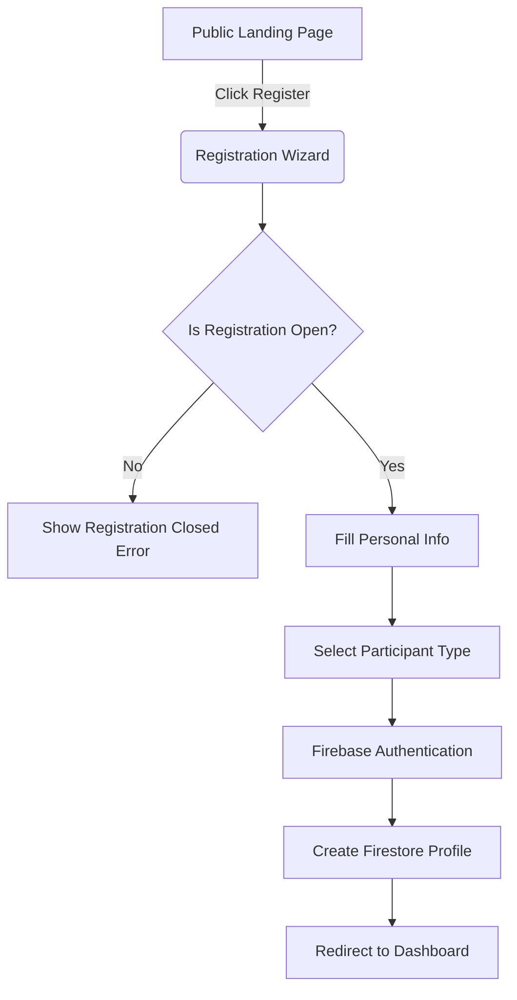
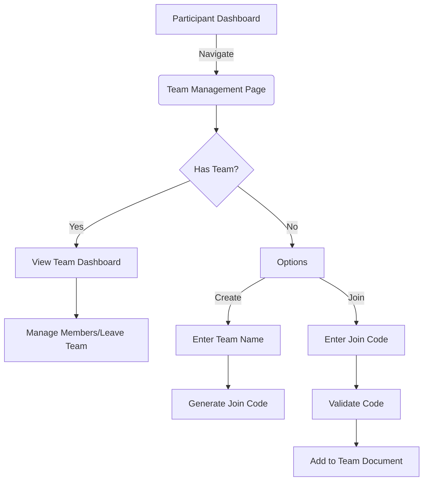
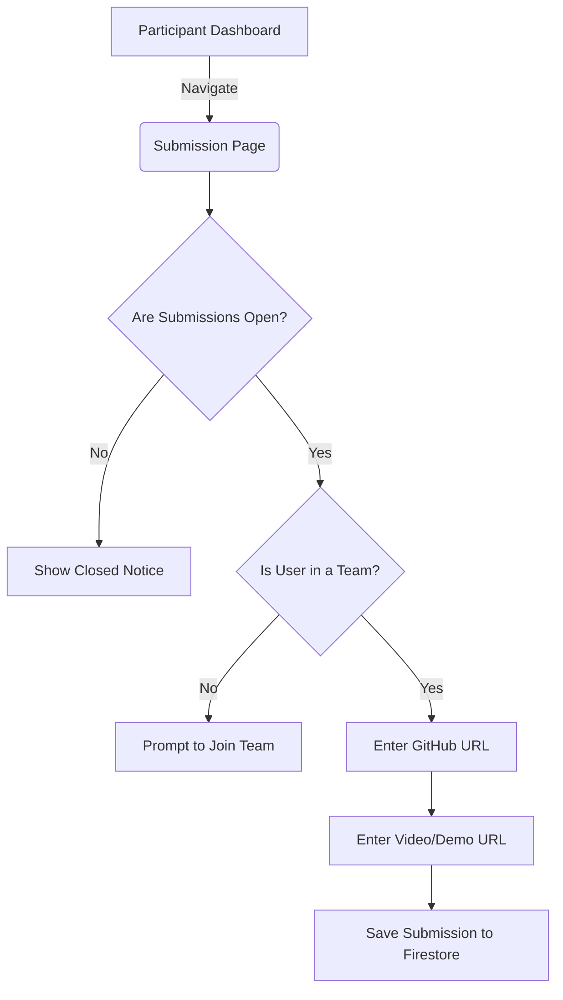
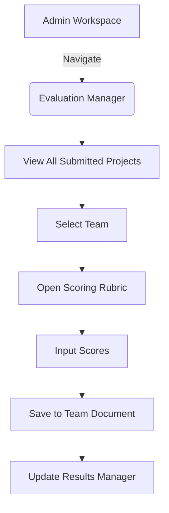
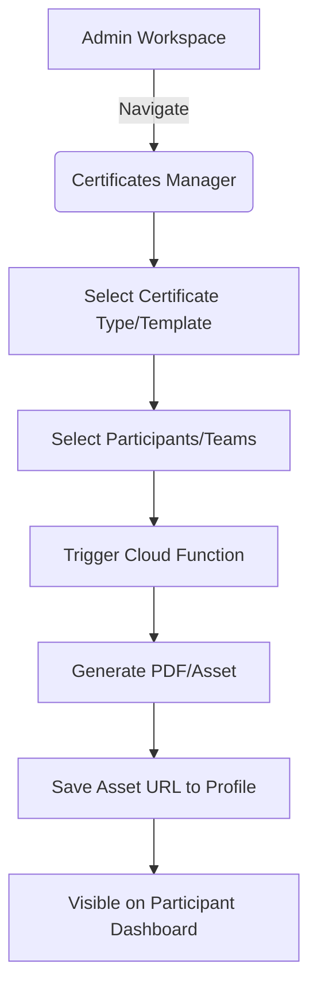

# GLITCH 36 Workflow Diagrams (Phase 1 Discovery)

These step-by-step flows describe the major processes on the live website based on source-code and authenticated route discovery.

## 1. Participant Registration Flow

## 2. Team Management Flow

## 3. Project Submission Flow

## 4. Admin Judging Flow

## 5. Admin Certificate Generation

